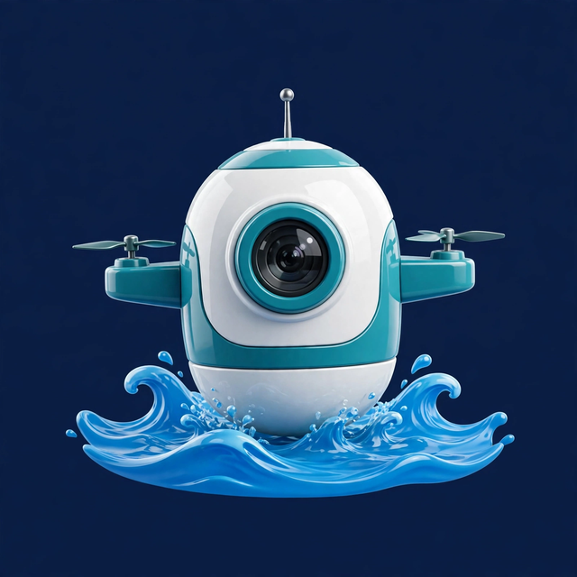

<div align="center">



# FIR — Floating Inspector Robot

**Robot inspeksi terapung berbiaya rendah untuk memantau kualitas air perairan pelabuhan dan memeriksa infrastruktur dermaga di zona garis air.**

[](https://www.espressif.com/en/products/socs/esp32-s3)
[](https://platformio.org/)
[](#fitur-firmware-v7102)
[](LICENSE)

[Konstruksi Fisik](#-konstruksi-fisik) · [Wiring Lengkap](#-wiring-lengkap) · [Daftar Belanja](#-daftar-belanja-bill-of-materials) · [Build Firmware](#-build-firmware) · [Build Aplikasi Android](#-build-aplikasi-android)

</div>

---

## Tentang FIR

**FIR (Floating Inspector Robot)** adalah robot terapung (buoy robot) yang dirancang, dirakit, dan diprogram **sendiri dari nol** sebagai karya pribadi. Robot ini mengapung di permukaan air pelabuhan dan melakukan dua pekerjaan sekaligus:

1. **Memantau kualitas air** — suhu, kekeruhan (turbidity), dan TDS (Total Dissolved Solids) diukur langsung di lokasi, lalu diringkas menjadi indeks **WQI (Water Quality Index)**.
2. **Menginspeksi infrastruktur dermaga secara visual** — kamera memeriksa dinding dermaga dan lambung kapal di **zona garis air** (waterline zone), zona yang paling rawan ditumbuhi biofouling dan mengalami korosi, tetapi mahal dan berbahaya bila diperiksa manual oleh penyelam.

Seluruh data tampil real-time di **dashboard web** yang disiarkan robot itu sendiri lewat WiFi (mode Access Point) dan di **aplikasi Android pendamping**. Tidak ada server, tidak ada cloud — robot adalah servernya.

Robot ini pernah dibawa ke **final KSTI 2026** (kategori IoT, ITS Surabaya).

## Istilah Penting

| Istilah | Arti |
|---|---|
| **WQI (Water Quality Index)** | Indeks tunggal 0–100 yang merangkum kualitas air dari gabungan suhu, kekeruhan, dan TDS. ≥80 = BAIK, 50–79 = SEDANG, <50 = BURUK. |
| **Zona garis air (waterline zone)** | Pita sempit di pertemuan permukaan air dan dinding dermaga/lambung kapal. Di sinilah biofouling dan korosi paling agresif, dan di sinilah kamera FIR bekerja. |
| **Kandidat korosi** | Area coklat/oranye pada foto yang skor analisanya ≥0,70. Robot hanya *menandai kandidat* — keputusan akhir selalu **perlu verifikasi operator**, robot tidak pernah mengklaim "mendeteksi karat". |
| **Mode AP (Access Point)** | Robot membuat hotspot WiFi sendiri bernama `FIR-Robot`; HP/laptop menyambung langsung ke robot tanpa router. |
| **Debounce alarm** | Alarm (banner merah + buzzer) hanya bunyi setelah **3× bacaan berbahaya berturut-turut**, supaya satu bacaan loncat tidak memicu alarm palsu. |
| **Rel 5V / rel 3V3** | Jalur tegangan bersama. Rel 5V memberi makan driver motor dan adaptor turbidity; rel 3V3 memberi makan sensor-sensor kecil. |

## Dua Misi

### Misi 1 — Stasiun Pemantau Kualitas Air Terapung
- **Suhu air** — probe DS18B20 waterproof terendam.
- **Kekeruhan** — sensor turbidity optik; hasil dibaca sebagai tegangan lalu diklasifikasikan *jernih / sedang / keruh*.
- **TDS** — probe TDS analog kompatibel Gravity.
- Ketiganya digabung menjadi **WQI** dan dicatat berkala (data logging ke microSD + riwayat di dashboard).

### Misi 2 — Inspeksi Visual Zona Garis Air
- Kamera **OV5640 5 MP** mengambil foto dinding dermaga/lambung kapal tepat di garis air.
- Foto dianalisa (model Edge Impulse yang berjalan di dalam ESP32-S3) untuk menandai **kandidat area korosi** dan biofouling.
- Foto tersimpan di microSD dan bisa ditinjau lewat dashboard (menu Riwayat Foto).

## Cara Kerja

1. **Ukur** — ESP32-S3 membaca semua sensor secara berkala: suhu, turbidity, TDS, level air, dan hujan.
2. **Nilai** — firmware menghitung WQI, memeriksa setiap parameter terhadap ambang batas, dan menerapkan debounce 3× sebelum menyatakan ALERT.
3. **Tampil & Gerak** — dashboard web + aplikasi Android menampilkan telemetri real-time; operator menggerakkan robot dengan joystick virtual (2 motor DC, differential thrust) sambil melihat hasil kamera.

### Ambang Batas (sesuai firmware v7.10.2)

| Parameter | Aman | Waspada / Bahaya |
|---|---|---|
| Turbidity | ≤ 0,53 V = **jernih** | 0,54–0,68 V = **sedang** · > 0,68 V = **keruh → ALERT** |
| Suhu air | 15–35 °C | ≥ 35 °C atau ≤ 15 °C = **bahaya** |
| TDS | < 500 ppm | ≥ 500 ppm = **bahaya** |
| WQI | ≥ 80 BAIK | 50–79 SEDANG · < 50 BURUK |

ALERT aktif setelah 3× bacaan berturut-turut melewati ambang → banner merah di dashboard + buzzer berbunyi 3 bip.

---

## 🛠️ Konstruksi Fisik

Robot dibangun dari bawah ke atas dalam lima lapisan: **tangkai sensor → lambung pelampung → box elektronik → penggerak → kamera & sensor udara**. Semua elektronik berada di atas garis air; yang terendam hanya probe sensor dan baling-baling.

### 1. Tangkai & Dudukan Sensor (bagian yang terendam)

Ini titik awal konstruksi — bagian yang benar-benar masuk ke air:

- Tiga probe menggantung dari lambung ke bawah permukaan air pada **tangkai/dudukan probe**: **DS18B20** (suhu), **probe turbidity** (kekeruhan), dan **probe TDS**. Ketiganya harus terendam penuh saat robot mengapung agar pengukuran sah.
- Probe turbidity adalah pasangan optik (LED inframerah + fototransistor) dalam rumah transparan; **hanya bagian transparannya yang boleh terendam** — kepala dan kabelnya tidak waterproof.
- **Sensor level air** dipasang di sisi lambung dekat garis apung untuk membaca ketinggian permukaan relatif terhadap badan robot.
- Semua kabel probe naik ke box elektronik melalui **1 cable gland** kedap air di dinding box — satu-satunya jalur kabel keluar-masuk box.
- Prinsipnya: semakin pendek dan kaku dudukan probe, semakin stabil bacaan; probe yang bergoyang bebas membuat angka turbidity dan TDS meloncat-loncat.

### 2. Lambung & Pelampung

- Badan apung berupa **rakit styrofoam** — ringan, murah, dan daya apungnya cukup untuk menopang box elektronik + baterai.
- Box elektronik duduk **di atas** rakit, sehingga seluruh papan dan baterai selalu di atas garis air.
- Pembagian berat dijaga simetris kiri–kanan supaya robot tidak miring; kemiringan lambung menggeser zona yang dilihat kamera dan kedalaman rendam probe.

### 3. Box Elektronik

- **Box hasil cetak 3D (3D printed enclosure)** menampung: ESP32-S3 CAM, modul TP4056, modul MT3608, driver DRV8833, baterai LiPo 1S, buzzer, dan papan penggabung kabel.
- Di dinding box terdapat **lubang lensa kamera** — lensa OV5640 mengintip keluar tepat menghadap zona garis air.
- **Saklar 2 kaki** di sisi box memutus/menyambung daya dari TP4056 ke MT3608 (saklar utama robot).
- **Sensor hujan LM393** (pelat pendeteksi + modul komparator) dipasang di permukaan atas box, terbuka ke langit, untuk mendeteksi hujan saat robot bertugas.
- Tidak ada rel/terminal pengumpul terpisah di dalam box: **semua kabel beban disolder gabung langsung di kaki pin ESP32-S3** (lihat bagian Wiring) — desain ini disengaja agar jumlah titik sambung minimum.

### 4. Penggerak

- **2 motor DC** (kiri dan kanan) dengan baling-baling, digerakkan driver **DRV8833**.
- Pola gerak **differential thrust**: maju = kedua motor searah; belok = satu motor lebih lambat/berlawanan; putar di tempat = kedua motor berlawanan arah. Pola ini membuat robot lincah bermanuver ke celah-celah kapal yang berlabuh.
- Kabel motor dibuat **paling tebal dan paling pendek** dibanding kabel lain, karena arus motor adalah arus terbesar di robot.

### 5. Kamera & Penyimpanan

- Modul kamera **OV5640** terhubung ke ESP32-S3 lewat kabel pita (ribbon) ke soket FPC di board.
- Slot **microSD** di board ESP32-S3 CAM menyimpan foto inspeksi dan log data.

---

## 🔌 Wiring Lengkap

### Arsitektur Daya

```
LiPo 1S 3,7 V 500 mAh
        │  B+ / B−
   ┌────▼─────┐        OUT+ ──► KAKI 1 saklar ──► KAKI 2 ──► MT3608 IN+
   │  TP4056  │        OUT− ───────────────────────────────► MT3608 IN−
   │ (charger │
   │+proteksi)│
   └──────────┘
                    MT3608 (step-UP, disetel 5,0 V)
                    OUT+ ──► pin 5V ESP32-S3      OUT− ──► pin GND ESP32-S3
                                  │
              ┌───────────────────┴───────────────────┐
           Rel 5V                                Rel 3V3 (regulator internal ESP)
     (menumpang kaki pin 5V ESP)           (menumpang kaki pin 3V3 ESP)
     • DRV8833 VCC                         • DS18B20 VCC
     • Adaptor turbidity pin V             • TDS +
                                           • Sensor level air +
                                           • Modul hujan LM393 VCC
              └──────────── GND bersama (kaki pin GND ESP) ───────────┘
```

- **TP4056** mengecas LiPo 1S lewat USB (cut-off 4,20 V) sekaligus memberi proteksi over-charge / over-discharge. Baterai tersambung ke pad **B+ / B−**; beban mengambil dari **OUT+ / OUT−**.
- **Saklar 2 kaki** duduk di jalur OUT+ → IN+ MT3608 (kedua kaki setara, tidak ada polaritas).
- **MT3608 adalah modul step-UP** (bukan step-down): menaikkan 3,7 V baterai menjadi **5,0 V**. Putar trimpotnya dan ukur dengan multimeter sampai OUT tepat 5,0 V **sebelum** disambung ke ESP.
- **Elco 100 µF** dipasang di OUT MT3608 (peredam kedip tegangan), dan **3× 100 µF paralel** di VCC–GND DRV8833 (peredam hentakan arus motor).
- ⚠️ **JANGAN PERNAH memakai baterai LiPo 3S (11,1 V) untuk robot ini.** Rangkaian dayanya dirancang untuk 1S.

### Tabel Pin ESP32-S3

| GPIO | Fungsi | Keterangan |
|---|---|---|
| GPIO1 | Turbidity — input analog | Lewat divider resistor (lihat bawah) |
| GPIO2 | TDS — input analog | Output modul TDS 0–2,3 V, aman untuk ADC |
| GPIO3 | Sensor level air — input analog | — |
| GPIO14 | DS18B20 — DATA (1-Wire) | Pull-up 4,7 kΩ ke 3V3 |
| GPIO21 | Buzzer | Bip alarm & umpan balik |
| GPIO38 | DRV8833 IN1 (motor kiri) | Berbagi pin dengan SD_CMD — lihat catatan |
| GPIO39 | DRV8833 IN2 (motor kiri) | Berbagi pin dengan SD_CLK |
| GPIO40 | DRV8833 IN3 (motor kanan) | Berbagi pin dengan SD_D0 |
| GPIO41 | DRV8833 IN4 (motor kanan) | — |
| GPIO42 | Sensor hujan LM393 — DO | Output digital komparator |
| GPIO44 | Tap status cas (CHRG TP4056) | Indikator pengecasan |
| GPIO45 | DRV8833 EEP (enable/sleep) | HIGH = driver aktif |

### Wiring per Komponen

**DS18B20 (suhu)** — VCC → rel 3V3 · GND → GND · DATA → GPIO14, dengan **resistor pull-up 4,7 kΩ antara DATA dan 3V3** (wajib, tanpa ini sensor tidak terbaca).

**Turbidity SEN-0175** — probe 3 kabel masuk ke papan adaptor (kuning = pin 1, biru = pin 2, merah = pin 3). Papan adaptor punya 4 pin **G A D V**:
- **V** → rel 5V · **G** → GND
- **A** (analog out) → **simpul divider** → GPIO1
- **D** (digital out) → tidak dipakai; ambangnya diatur trimpot biru **103** di adaptor — **jangan diputar**, firmware membaca jalur analog.
- ⚠️ **Peringatan keras:** pin A bisa mengeluarkan sampai **4,5 V**, sedangkan GPIO ESP32-S3 maksimum 3,3 V. Karena itu output A **wajib** melewati jaringan resistor **20 kΩ ke 3V3 + 20 kΩ ke GND** dengan simpul tengahnya masuk GPIO1. Menyambung A langsung ke GPIO akan merusak pin.

**TDS (kompatibel Gravity)** — pin **+** → rel 3V3 · **−** → GND · **A** (analog out) → GPIO2.

**Sensor level air** — **+** → rel 3V3 · **−** → GND · **S** (sinyal) → GPIO3.

**Sensor hujan LM393** — VCC → rel 3V3 · GND → GND · **DO** → GPIO42 (AO tidak dipakai).

**DRV8833 (driver motor)** — VCC → rel 5V (pin ke-3 kolom kiri modul — **rawan tertukar**, periksa silkscreen) · GND → GND · IN1–IN4 → GPIO38/39/40/41 · EEP → GPIO45 · **OUT1+OUT2 → motor kiri** · **OUT3+OUT4 → motor kanan** · pin ULT/FAULT dibiarkan kosong.

**Buzzer** — kaki sinyal → GPIO21 · kaki lain → GND.

**Catatan pin bersama:** GPIO38/39/40 dipakai bergantian oleh driver motor dan bus microSD (SD_CMD/SD_CLK/SD_D0). Firmware v7.10.2 menangani ini dengan membatasi percobaan mount SD dan memberi cooldown, tetapi konsekuensinya akses SD paling andal saat driver motor tidak berdaya.

> Diagram visual lengkap tersedia di folder [`docs/`](docs/): **Wiring_FIR_Terkini_10Nov2026.pdf** (diagram wiring keseluruhan) dan **Diagram_Wiring_Per_Komponen_FIR_Terkini.pdf** (satu diagram per komponen).

---

## 🧾 Daftar Belanja (Bill of Materials)

Link di bawah adalah **contoh listing nyata** yang diverifikasi pada November 2026 — harga dan stok bisa berubah. Tokopedia untuk pembelian di Indonesia; Amazon untuk referensi internasional (beberapa produk Amazon adalah padanan keluarga yang sama, bukan unit persisnya).

| # | Komponen | Fungsi | Tokopedia | Amazon |
|---|---|---|---|---|
| 1 | **ESP32-S3 CAM N16R8 + kamera OV5640** | Otak robot: MCU, WiFi, kamera, slot microSD | [Beli](https://www.tokopedia.com/rosesana/esp32-s3-wroom-n16r8-with-ov5640-cam?extParam=ivf%3Dfalse%26keyword%3Desp32+cam+ov5640%26search_id%3D20261104010422ED57D5A221CE51017753%26src%3Dsearch) | [Beli (kit Freenove ESP32-S3 CAM)](https://www.amazon.com/dp/B0BMQ2CPQN) |
| 2 | **DS18B20 waterproof** (kabel 1 m) | Sensor suhu air | [Beli](https://www.tokopedia.com/aifrobotic/ds18b20-waterproof-temperature-sensor-suhu-1m-2m-3m-5m-3m-50628) | [Beli (Gikfun)](https://www.amazon.com/dp/B012C597T0) |
| 3 | **Turbidity SEN-0175** (probe + adaptor G A D V) | Sensor kekeruhan air | [Beli (modul keluarga sama, Rajacell)](https://www.tokopedia.com/rajacell/turbidity-sensor-module-deteksi-kualitas-kejernihan-air-for-arduinoo-ab147) · unit asli dibeli di [CNC Store Bandung (Shopee)](https://shopee.co.id/Turbidity-Sensor-Module-–-Sensor-Kekeruhan-Air-Kejernihan-Air-untuk-Arduino-Mikrokontroler-i.62956347.20284260245) | [Beli (padanan: DFRobot Gravity SEN0189)](https://www.amazon.com/dp/B075T3CVH6) |
| 4 | **Sensor TDS analog** (kompatibel Gravity) | Sensor zat terlarut | [Beli](https://www.tokopedia.com/digiware/tds-sensor-meter-water-quality-total-dissolved-solids-grove) | [Beli (CQRobot)](https://www.amazon.com/dp/B08KXRHK7H) |
| 5 | **DRV8833** dual H-bridge | Driver 2 motor DC (3–10 V, 1,5 A/kanal) | [Beli](https://www.tokopedia.com/rajacell/drv8833-2-channel-dc-motor-driver-module-board-15a-3v-10v-for-arduino) | [Beli](https://www.amazon.com/dp/B0C6WRFJWM) |
| 6 | **MT3608** step-up DC-DC | Menaikkan 3,7 V → 5,0 V | [Beli](https://www.tokopedia.com/eltech-online/mt3608-2-24v-step-up-to-5-28v-2a-dc-dc-converter-power-modul) | [Beli](https://www.amazon.com/dp/B0FSX55BGL) |
| 7 | **TP4056 versi proteksi** (DW01) | Charger + proteksi LiPo 1S | [Beli](https://www.tokopedia.com/emarket-id/lithium-battery-charging-tp4056-5v-1a-micro-usb-modul) | [Beli](https://www.amazon.com/dp/B08F7QSLN7) |
| 8 | **LiPo 1S 3,7 V 500 mAh** | Baterai utama | [Cari](https://www.tokopedia.com/find/lipo-500mah) | [Beli (EEMB LP403048)](https://www.amazon.com/dp/B095W6742D) |
| 9 | **Sensor hujan LM393** (raindrops module) | Deteksi hujan di atas box | [Beli](https://www.tokopedia.com/digpart/raindrops-detection-sensor-module-rain-weather-detektor-air-hujan) | [Beli (HiLetgo)](https://www.amazon.com/HiLetgo-Moisture-Humidity-Sensitivity-Nickeled/dp/B01DK29K28) |
| 10 | **Sensor level air** (water level sensor) | Ketinggian permukaan air di lambung | [Beli](https://www.tokopedia.com/rajacell/new-water-level-sensor-gold-coating-for-arduino-sensor-ketinggian-air) | [Beli (Songhe)](https://www.amazon.com/dp/B07THDH7Y4) |

**Komponen pendukung** (generik, tersedia di hampir semua toko elektronik):
- 2× motor DC kecil + baling-baling (propeller) kiri/kanan
- Buzzer aktif 3,3–5 V
- Kapasitor elektrolit 100 µF (4 buah: 1 di OUT MT3608, 3 paralel di DRV8833)
- Resistor 4,7 kΩ (pull-up DS18B20) dan 20 kΩ ×2 (divider turbidity)
- Saklar geser/toggle 2 kaki
- microSD card (untuk foto + log)
- Bahan lambung: styrofoam, filamen cetak 3D untuk box, cable gland, kabel serabut (kabel motor pakai yang paling tebal), solder, dan heat shrink

---

## Fitur Firmware v7.10.2

- Dashboard web responsif di mode AP (`192.168.4.1`) — telemetri, joystick motor, kamera, riwayat foto.
- Perhitungan **WQI** real-time + klasifikasi turbidity jernih/sedang/keruh.
- Sistem **ALERT berjenjang** dengan debounce 3× bacaan + buzzer 3 bip.
- Analisis foto **Edge Impulse** di perangkat (on-device) untuk skor kandidat korosi.
- Data logging ke microSD yang **tidak menyandera boot**: mount dibatasi 3× percobaan saat boot (2× di sesi lain) + cooldown 45 detik setelah gagal total.
- Halaman admin tersembunyi `/adminin` untuk override label klasifikasi turbidity (0 = otomatis, 1 = jernih, 2 = sedang, 3 = keruh; tersimpan persisten di LittleFS).
- WiFi-only (tanpa Bluetooth) agar koneksi stabil dan konsumsi daya rendah.

## Struktur Repo

```
Floating-Inspector-Robot/
├── firmware/        # Proyek PlatformIO — firmware ESP32-S3 CAM (v7.10.2)
│   ├── platformio.ini
│   ├── src/main.cpp
│   └── lib/         # OneWire, DallasTemperature, model Edge Impulse
├── android-app/     # Source aplikasi Android pendamping (WiFi)
├── docs/            # PDF diagram wiring keseluruhan + per komponen
├── logo.png         # Logo 3D FIR
├── LICENSE          # MIT
└── README.md
```

## 🔧 Build Firmware

Butuh [PlatformIO](https://platformio.org/).

```bash
cd firmware
pio run              # build
pio run -t upload    # flash ke board (saklar baterai OFF saat flash via USB)
```

> ⚠️ **Kredensial WiFi:** di `firmware/src/main.cpp` sekitar baris 1372–1379 terdapat konstanta `WIFI_SSID`, `WIFI_PASS`, dan `AP_PASS` yang di repo ini sudah diganti **placeholder** (`NAMA_WIFI_ANDA`, `PASSWORD_WIFI_ANDA`, `PASSWORD_AP_ANDA`). Isi dengan kredensialmu sendiri sebelum build. Jangan pernah commit password asli.

## 📱 Build Aplikasi Android

Buka folder `android-app/` di Android Studio, lalu **Build → Build APK**. Aplikasi menyambung ke hotspot `FIR-Robot` dan membuka dashboard robot — tidak perlu internet.

## Cara Pakai Singkat

1. Cas baterai lewat port USB TP4056 sampai penuh (4,20 V).
2. Nyalakan saklar — robot membuat hotspot **`FIR-Robot`**.
3. Sambungkan HP ke hotspot itu, buka **`192.168.4.1`** atau aplikasi Android FIR.
4. Uji motor **hanya dari daya baterai dengan saklar ON** (uji dari USB tidak sah — driver motor mengambil daya dari jalur baterai, bukan USB).
5. Gerakkan robot ke titik ukur, biarkan probe terendam stabil, lalu baca WQI dan ambil foto inspeksi.

## Keterbatasan yang Diketahui

- GPIO38/39/40 dipakai bersama oleh driver motor dan bus microSD — akses SD paling andal saat motor tidak berdaya (dijelaskan di bagian Wiring).
- Klasifikasi turbidity bersifat relatif terhadap kalibrasi tegangan firmware (jangkar CLEAR 0,42 V / DARK 0,85 V), bukan pembacaan NTU laboratorium.
- Skor korosi adalah **kandidat** untuk diverifikasi operator, bukan vonis kondisi material.

## Lisensi

Dirilis di bawah [Lisensi MIT](LICENSE) — © Kizuko499.

<div align="center">


**FIR — Floating Inspector Robot** · Karya pribadi · Dibangun dari nol dengan ESP32-S3
</div>
